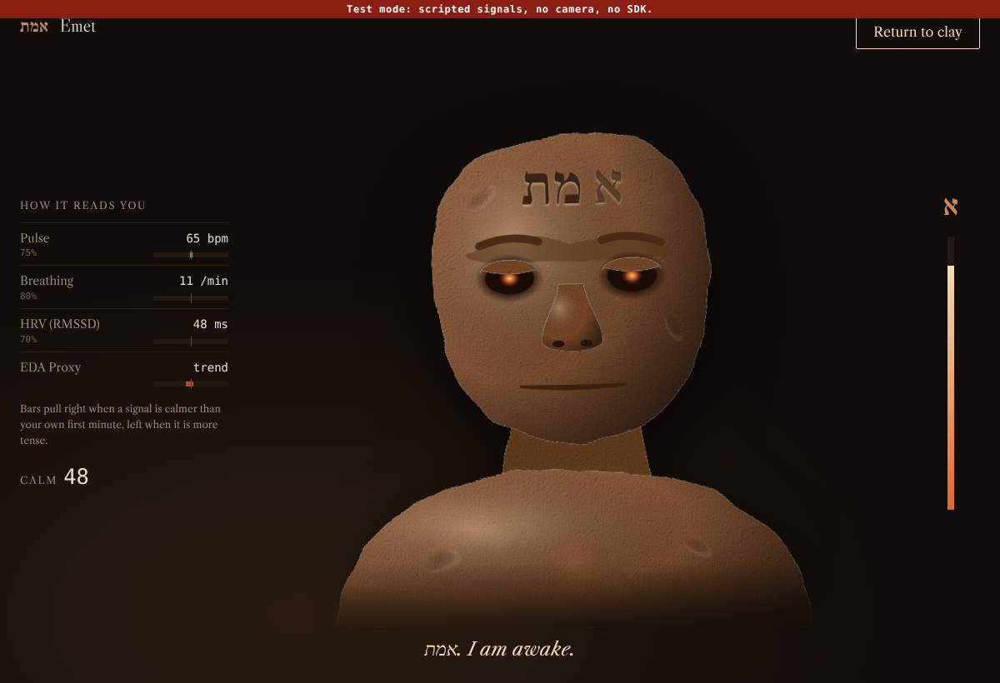

# Emet · אמת

**A clay golem that lives only while you stay calm.** Built on [Presage SmartSpectra](https://smartspectra.presagetech.com/), which reads pulse, breathing and more from an ordinary camera.

In the Prague legend, Rabbi Loew wrote אמת (*emet*, truth) on the golem's forehead. Erase the first letter and it reads מת (*met*, dead). This golem is shaped from you: it breathes with your chest, its heart glows with your pulse wave, and its face follows yours. The א holds only while you stay calm. Tense up, and the letter fades, the clay cracks and the golem sinks. Breathe, and it rises again.



## What it reads, and what it does with it

| SmartSpectra signal | What the golem does |
|---|---|
| Chest breathing waveform | Its chest and shoulders rise and fall with yours |
| Relative arterial pressure waveform | The ember in its chest glows with each pulse wave |
| Pulse rate, breathing rate, HRV (RMSSD), EDA Proxy trend | Compared with **your own first minute**; together they hold or erase the א |
| 478 face landmarks | Its eyelids, brows, mouth and head follow yours |
| Blinking, talking | It blinks when you blink; an ember lights by its ear while you talk (and it stops counting breaths, which talking spoils) |
| Validation status | Camera guidance, in the golem's voice ("It is too dark. Bring a light closer.") |

The first 60 seconds are the **shaping**: the golem learns your baseline (HRV needs a full 60-second window; EDA Proxy its first ~35 seconds). After that, every signal is read relative to *you*, not to a norm, and the panel on the left shows which way each one pulls.

## Run it

You need Windows x64, macOS on Apple Silicon, or Linux x64/ARM64 (glibc 2.35+), [Node.js 20+](https://nodejs.org/) (24 LTS recommended), and a free Presage developer key from [physiology.presagetech.com](https://physiology.presagetech.com/auth/register).

```bash
git clone https://github.com/nightclerk/emet.git
cd emet
npm install
npm start
```

On first launch, paste your key. It is stored in the app's local storage on your computer only. Then choose **Wake it with my camera** or **Use a video file**.

For the best reading, sit still in good, steady light with your face and upper chest in view (the SDK's own guidance: no flickering screens behind you, no chewing gum).

`npm run mock` opens the golem with scripted signals and no camera or key, for trying the interface. `npm test` runs the unit tests for the signal logic.

## Consent and data handling

- **Camera consent.** Nothing starts until you press *Wake it*. The camera permission is granted only to the app's own local page, video only (never the microphone). *Return to clay* stops the camera at once.
- **On device.** The SDK computes every metric on your computer. The app never shows, records or saves your camera image; the golem is drawn from numbers.
- **Nothing kept.** Readings live in memory for the session only and are dropped when you stop or close the app. There is no account, no analytics, no server of ours.
- **Network.** The SDK contacts Presage to check your API key. Presage's aggregate SDK diagnostics (session summaries, no video, no vital signs; see [their telemetry page](https://smartspectra.presagetech.com/docs/telemetry-and-privacy)) are **off by default** and can be turned on with a checkbox.
- **Video files.** Use only video of someone who has agreed to it.
- **Not medical.** "Calm" is a playful comparison with your own first minute. The app makes no diagnosis or health claim, and SmartSpectra metrics are for general wellness and informational purposes only.

## How it's built

- Electron app; the Presage Node.js SDK runs in the main process, the renderer sends it camera (or video file) frames through the SDK's own IPC bridge.
- `src/signals.js`: baselines from the shaping minute, relative calm, EDA Proxy slope, with unit tests.
- `src/face.js`: eye, brow, mouth, roll and yaw from the 478 landmarks.
- `src/golem.js`: the golem, in SVG. Clay texture is `feTurbulence` + `feDiffuseLighting`; the hand-pressed edges are a `feDisplacementMap`.
- If a key isn't authorized for a metric group, the app retries without it (EDA first, then face) instead of failing.

## License

MIT for this project's code. The Presage SmartSpectra SDK is proprietary and installed from npm under [Presage's terms](https://physiology.presagetech.com/tos). Fonts: Libre Caslon and Frank Ruhl Libre (SIL Open Font License, see `fonts/`).
